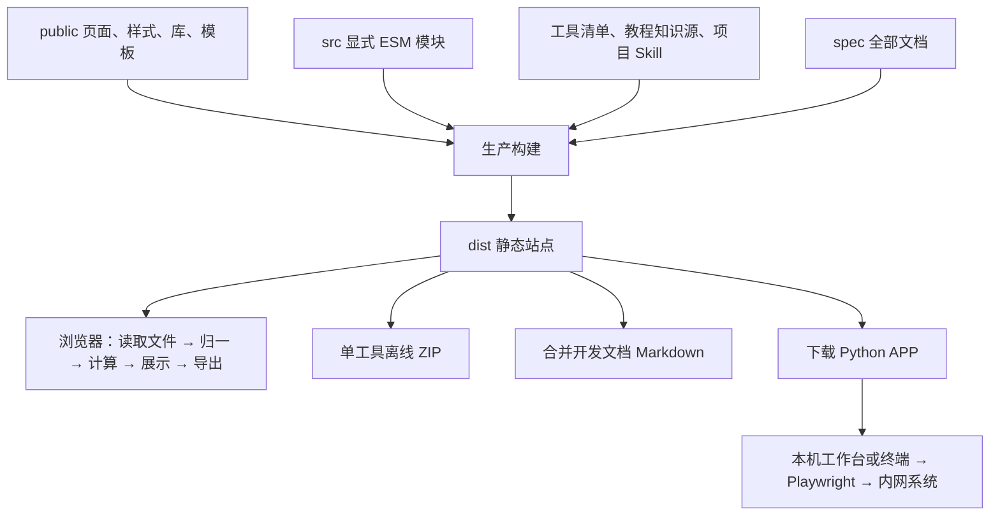

# 系统架构

## 系统组成与运行边界

看门狗是原生 HTML/CSS/TypeScript 构成的静态浏览器工具集合，使用 esbuild 构建，不使用前端应用框架、统一业务数据库或常驻业务服务器。GitHub Pages 发布的是 `dist/`。大多数工具在本机浏览器读取文件、计算、预览并下载新文件。

三个 Python 自动化工具另行启动本机程序：锁班乞丐、飞行经历查询、自动点 OA 助手。它们通过 Playwright 访问内网，不能因网站采用静态托管就认为其业务动作也只在本地。锁班会提交及可能解锁生产记录，OA 会改变待办状态；飞行经历查询读取门户数据。

## 文件职责

| 位置 | 当前职责 | 重建需要保留的契约 |
| --- | --- | --- |
| `public/index.html` | 根入口跳转 | 子路径部署后仍能到工具首页 |
| `src/tool/tools-data.ts` | 工具名称、标识、说明、分类、状态、可见性 | 同一清单驱动首页、README 工具表和独立包；顺序来自清单 |
| `public/tool/index.html`、`src/tool/tools-render.ts` | 搜索、分类、工具卡片、彩蛋和下载 | 状态、分类、显示名称是不同字段；弃用工具仍可访问 |
| `public/tool/app/<entry>/` | 页面、领域样式、静态资源及部分 Python APP | 页面与构建入口配对；不能假定 Python 都在 src |
| `src/tool/app/<entry>/` | 浏览器业务、数据模型和接线 | 规则与展示分离，显式导入导出 |
| `public/theme.css`、`theme.js` | 公共主题与主题选择 | 页面共享 token、主题状态和切换事件 |
| `public/libs/`、`versions.json` | 本地第三方库及版本来源清单 | 库文件、Worker、许可证同时保留 |
| `public/template/` | 固定花名册与业务模板 | 结构、公式、样式和归档项有业务意义，不能只留空表头 |
| `scripts/build.mts` | 页面与 Worker 清单、复制、编译、数据和离线产物 | 每个生产页面一个应用 ESM；第三方 UMD 在适配边界使用 |
| `scripts/tool-exports.mts` | 每工具 IIFE 与离线资源组装 | 每个工具单独 ZIP，根 index 可打开；本地 fetch/Worker 有离线适配 |
| `src/tool/project-archive.ts` | 审计、校对完整项目归档 | 先验证版本、路径、大小和 SHA-256，再替换状态 |
| `spec/` | 系统、开发规格、用户手册与核查证据 | 单一业务事实源、合并文档输入 |
| `tests/tool/`、`tests/python/`、`tests/smoke/` | 业务规则、Python 及交付接线证据 | 自动测试不依赖真实业务表或登录内网 |

## 应用内部的数据流

典型 Excel 工具：用户选择文件 → SheetJS 读取单元格与表头 → 输入边界转为稳定业务模型 → 纯规则函数计算结果与问题 → 同一结果驱动摘要、明细和导出。姓名、员工号、日期和资质值的归一必须按工具规格执行，各工具不能机械共用同一“真值”或人员范围。

页面状态归应用实例。文件替换、参数改变与异步任务完成之间需要防止旧结果回写；各工具实际的失效和重试边界以自身规格为准。浏览器刷新通常丢失内存状态，跨会话恢复依赖导出的工作簿或完整项目包，主题与水族箱开关例外，保存在浏览器本地。

文档工具：Mammoth/PDF.js 读取 → 保留原文位置 → 检索或对齐 → 人工确认 → 报告与项目文件。OCR、合规判断和自动认定业务等价不属于当前能力。

Python 工作台：loopback HTTP → 单 worker/浏览器会话 → 人工认证 → 按记录串行执行 → 逐条结果落盘 → 前端状态轮询。健康检查与开始执行是不同命令；不能在重建中擅自将提示改成提交许可，或将部分成功整单重跑。

## 公共子系统

**备忘录**：`public/memo/index.html` 为壳，`src/memo/memos-data.ts` 为导航索引，`search.ts` 负责正文检索，`site.ts` 负责分类、hash、Markdown 加载、高亮和单篇下载。正文与相对图片在 `public/memo/memos/`；模块完整规格在 `public/memo/SPEC.md`，人工索引在 `MEMO_INDEX.md`。当前索引为人类看条目，保留的 agent 分类不意味着已引入皮燕子合集。下载只保存单篇 Markdown，不自动携带图片。

**开发者页**：`public/tool/developer.html` 和 `src/tool/developer.ts` 展示构建生成的 `skills-data.json` 与 `version.json`。Skill 来自 `.agents/skills`，两个手册阅读 Skill 被构建过滤。版本仅保存 Git 提交事实；不写机器路径、分支和构建时间。该页与首页提供同一份合并开发文档下载。

**水族箱**：`public/tool/habitats/` 是首页 iframe 隔离背景，由 `src/tool/habitats-background.ts` 接线，默认关闭，不能拦截业务点击。`npm.cmd run test:habitats` 是独立脚本；它没有被 `npm.cmd run verify` 调用，不能将两者覆盖范围混为一谈。

**菜鸟教程知识源**：`content/manifest.json`、`sources.json`、`modules/*.json` 与 Markdown 由 `scripts/beginner-tutorial-content.mts` 校验后输出单一数据文件。它是产品业务内容，不是 `spec/user` 的替代品；重建时须另外保存知识源，不能从教程操作手册推导全部知识条目。

## 构建、类型与发布

基准环境与 Pages 配置一致：Node 22、Python 3.12、`npm ci`、根 `requirements.txt`。锁定 npm 依赖以 `package-lock.json` 为准，浏览器本地库以 `public/libs/versions.json` 为准；只看 `package.json` 版本范围不足以复原依赖。

全部 TypeScript 使用根 `tsconfig.json`，当前 `strict: true`、`noImplicitAny: true`、`noEmit: true`。类型检查通过不证明 Excel 动态数据、第三方全局或外部系统行为正确。

`npm.cmd run build` 的 prebuild 同步 README 工具表，再清理并生成 `dist`：静态文件、页面 ESM、source map、比较 Worker、Python 资源、教程与 Skill 数据、独立工具 ZIP、合并开发文档、构建清单和 Git 版本。`.standalone` 中间产物在构建后清除。新增页面需同时登记 `pageEntries`，新增工具需登记工具清单。

`npm.cmd test` 先构建再运行全部 Vitest，随后运行 Python unittest；因此每次标准测试重新扫描文档。直接执行 `npx.cmd vitest run` 不等价于标准测试前置流程。`verify` 还执行 README 一致性、类型检查和两个隔离临时目录的确定性构建。`build-manifest.json` 记录页面源码、页面、输出和 SHA-256，不是完整站点文件清单。

Pages 工作流 `.github/workflows/deploy-pages.yml` 在 master 推送或手工触发后安装依赖、执行 verify、只上传 dist 并部署。源码恢复、业务重建和发布验收见[重建与验收](reconstruction.md)。
